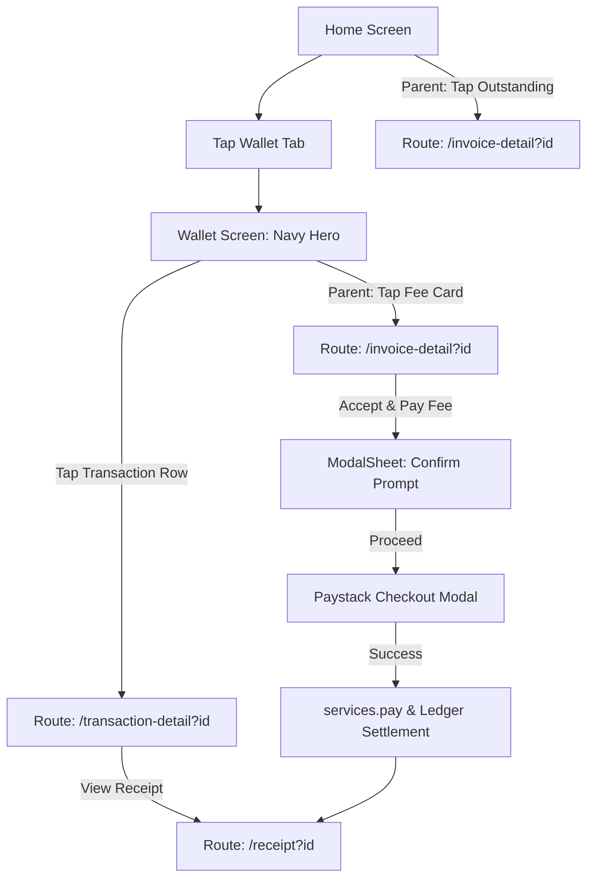
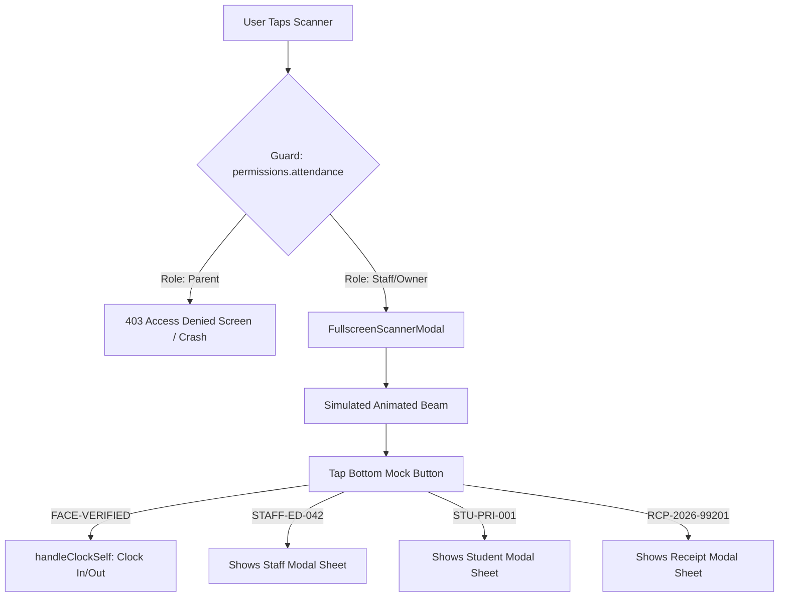
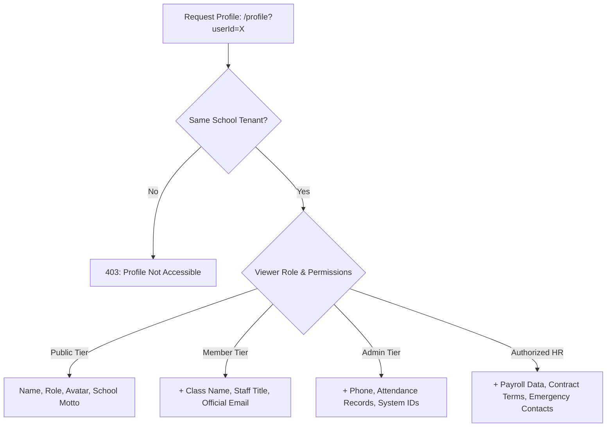
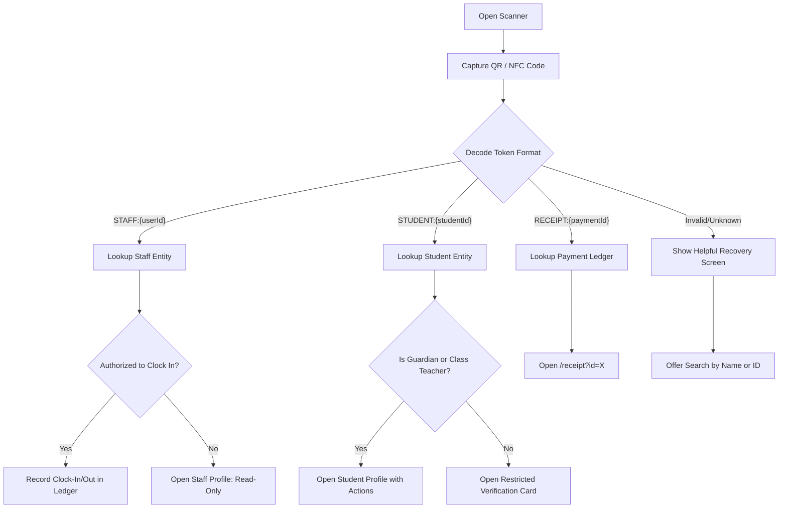

# SchoolDay Mobile Application — System Architecture, Audit & Redesign Specification

> **Document Status:** Complete Architecture, Audit & Redesign Specification (Phases 0 — 6 Fully Executed & Verified)  
> **Target Package:** `apps/mobile` (`@school/mobile`)  
> **Author:** Senior Staff Mobile Engineer, Principal Product Designer & Design Systems Engineer  
> **Date:** October 2026  

---

## Table of Contents
1. [Executive Summary](#1-executive-summary)
2. [Section A: Product Overview](#section-a-product-overview)
3. [Section B: Current Screen Inventory](#section-b-current-screen-inventory)
4. [Section C: Current Navigation & User Journeys](#section-c-current-navigation--user-journeys)
5. [Section D: Component & Codebase Architecture](#section-d-component--codebase-architecture)
6. [Section E: Existing Design System & Design Tokens](#section-e-existing-design-system--design-tokens)
7. [Section F: Audit Findings & Prioritized Issues (P0 / P1 / P2)](#section-f-audit-findings--prioritized-issues-p0--p1--p2)
8. [Section G: Preservation vs. Redesign Decision Matrix](#section-g-preservation-vs-redesign-decision-matrix)
9. [Section H: Evaluation of the Figma Inspiration](#section-h-evaluation-of-the-figma-inspiration)
10. [Proposed Mobile Redesign Specification](#proposed-mobile-redesign-specification)
    - [A. Design Quality & Brand Foundations](#a-design-quality--brand-foundations)
    - [B. Role-Tailored Home Experience](#b-role-tailored-home-experience)
    - [C. Financial & Treasury Architecture (Wallet)](#c-financial--treasury-architecture-wallet)
    - [D. Dynamic Role-Based Profile Architecture](#d-dynamic-role-based-profile-architecture)
    - [E. Public Profiles & Multi-Tiered Visibility](#e-public-profiles--multi-tiered-visibility)
    - [F. Intent-Driven Scanner Architecture](#f-intent-driven-scanner-architecture)
    - [G. Component & Architecture Migration Plan](#g-component--architecture-migration-plan)
11. [Redesign Roadmap (Phases 0 — 6)](#redesign-roadmap-phases-0--6)
12. [Unresolved Product Questions & Assumptions](#unresolved-product-questions--assumptions)

---

## 1. Executive Summary

`@school/mobile` is an enterprise, offline-first React Native mobile application built on Expo SDK 58 and Expo Router. It serves as the primary operational handheld interface for primary and secondary educational institutions across Nigeria and Sub-Saharan Africa.

This document represents the outcome of **Phase 0: Architectural & UX Audit**. It documents the system as it actually exists, establishes an evidence-based inventory of verified features versus mock fallbacks, identifies severe usability, navigation, and permission defects, and articulates a complete product specification for subsequent redesign phases.

In accordance with strict engineering discipline:
- **No production redesign code has been written in this phase.**
- The existing **Splash**, **Onboarding Carousel**, and **Authentication (Email + OTP)** flows are verified as architecturally sound and are **preserved**.
- The core workspaces requiring systematic redesign in subsequent phases are: **Home**, **Wallet / Treasury**, **Profile System**, and **Scanner**.

---

## Section A: Product Overview

### 1. Intended Purpose
The mobile application is designed to digitalize daily school operations for multi-tenant educational institutions. It empowers school proprietors, administrators, educators, bursars, HR directors, and parents to execute mission-critical school functions:
- Real-time tuition collection, invoice issuance, and Paystack settlement.
- Biometric facial / QR-code attendance verification for faculty and pupils.
- Academic class creation, stream allocation, and curriculum timetable tracking.
- Staff payroll computation, allowance/deduction tracking, and treasury disbursements.
- Secure parent-to-school communication, announcements, and digitally signed receipts.

### 2. Supported User Roles
The application defines seven distinct roles in [`apps/mobile/src/domain/model.ts`](file:///Users/mac/Documents/SIDE%20PROJECTS/SCHOOL-MGT/apps/mobile/src/domain/model.ts#L3-L13):
1. **`owner` (School Proprietor):** Executive governance, institution registration, bank account allocation, fee structures, faculty compensation, and full campus audit rights.
2. **`admin` (School Administrator):** Operational management, student admissions, class setups, staff invitations, and daily administrative approvals.
3. **`teacher` (Classroom Educator):** Classroom roll call, lesson plan authoring, student duty tracking, leave requests, and digital ID card.
4. **`parent` (Parent / Legal Guardian):** Linked children roster, fee invoice clearance via Paystack, bank transfer verification, academic calendar inspection, and official digital receipts.
5. **`finance` (Bursar / Accounts Officer):** Treasury ledger management, fee collection tracking, pending transfer reconciliation, invoice generation, and expense auditing.
6. **`hr` (Human Resources Officer):** Faculty directories, leave request approvals, staff attendance reviews, and monthly payroll computation.
7. **`staff` (Non-Teaching Staff):** Daily clock-in/out attendance, duty schedules, leave applications, and personal digital ID pass.

### 3. Application Entry Point & Navigation Architecture
- **Root Layout:** [`apps/mobile/app/_layout.tsx`](file:///Users/mac/Documents/SIDE%20PROJECTS/SCHOOL-MGT/apps/mobile/app/_layout.tsx) initializes the `GestureHandlerRootView`, `AppProvider`, `ErrorBoundary`, loads Google Fonts (`Manrope_400Regular` through `800ExtraBold`), and mounts Expo Router's `<Stack screenOptions={{ headerShown: false }} />`.
- **Router Root:** [`apps/mobile/app/index.tsx`](file:///Users/mac/Documents/SIDE%20PROJECTS/SCHOOL-MGT/apps/mobile/app/index.tsx) inspects the session context via `useApp()`. If an authenticated session exists (`app.ready && app.context`), it immediately redirects to `/(workspace)/home`. Otherwise, it presents the entry router component [`apps/mobile/src/features/Entry.tsx`](file:///Users/mac/Documents/SIDE%20PROJECTS/SCHOOL-MGT/apps/mobile/src/features/Entry.tsx).
- **Workspace Navigation:** [`apps/mobile/app/(workspace)/_layout.tsx`](file:///Users/mac/Documents/SIDE%20PROJECTS/SCHOOL-MGT/apps/mobile/app/%28workspace%29/_layout.tsx) wraps the bottom navigation tab bar using a custom floating navigation component ([`FloatingNav`](file:///Users/mac/Documents/SIDE%20PROJECTS/SCHOOL-MGT/apps/mobile/src/features/Workspace.tsx#L190)).
  - Active Tab Routes: `home`, `wallet`, `messages`, `notifications`, `more`.
  - Hidden Tab Route: `work` (`options={{ href: null }}`).

### 4. Integration Status: Verified vs. Mock vs. Local
| Feature Area | Current Status | Underlying Architecture & Verification |
| :--- | :--- | :--- |
| **Authentication & OTP** | **Hybrid Real / Local** | Dispatches real emails via **Resend API** (`hello@padeespace.com`) when online; local state fallback for test OTPs. |
| **School Registration** | **Hybrid Real / Local** | Proprietor registration saves locally to device storage (`AsyncStorage`) and syncs to backend `/api/v1/schools` if accessible. Generates dedicated virtual NUBAN. |
| **Payments & Paystack** | **Simulated / Client Gateway** | `PaystackCheckoutModal` provides card/transfer/USSD checkout simulation; stores settled payment records locally and triggers ledger updates. |
| **Attendance & Geofencing** | **Offline-First Local** | Records `inAt`, `outAt`, `photoVerified`, and `locationName` locally with state `"Waiting to sync"`. No live GPS/hardware geofencing active. |
| **Facial & QR Scanner** | **Simulated Software Mock** | `FullscreenScannerModal` runs an animated laser scan overlay with bottom simulation buttons (`FACE-VERIFIED`, `STAFF-ED-042`, `STU-PRI-001`, `RCP-2026-99201`). No native `expo-camera` integration. |
| **Public Profile Lookups** | **Broken / Missing** | Profile route `/profile` aliases `/more`. There is no dedicated public profile screen or role-segmented visibility engine. |

---

## Section B: Current Screen Inventory

| Route | Feature Component | Target Role | Primary Purpose | Key Content & Hierarchy | Usability & Design Defects |
| :--- | :--- | :--- | :--- | :--- | :--- |
| `app/index.tsx` | [`Entry.tsx`](file:///Users/mac/Documents/SIDE%20PROJECTS/SCHOOL-MGT/apps/mobile/src/features/Entry.tsx) | All | Entry gatekeeper & auth orchestrator | Controls sub-views: `carousel` (Onboarding), `login` (OTP), and `create` (School setup). | None. Clean, modular, and functional. |
| `app/(workspace)/home.tsx` | [`Home.tsx`](file:///Users/mac/Documents/SIDE%20PROJECTS/SCHOOL-MGT/apps/mobile/src/features/Home.tsx) | All Roles | Primary operational dashboard | Header greetings, school cover banner, attention hub, executive metric cards, quick action chips, notices. | **Severe visual crowding (1,518 lines)**. Excessive cards, redundant metric boxes, chaotic color accents (`#4F46E5`, `#EA580C`, `#059669`, `#0284C7`). |
| `app/(workspace)/wallet.tsx` | [`WalletScreen.tsx`](file:///Users/mac/Documents/SIDE%20PROJECTS/SCHOOL-MGT/apps/mobile/src/features/WalletScreen.tsx) | Owner, Bursar, Parent | Campus treasury & parent fee management | Midnight navy hero balance card, circular action buttons (Send, Request, Top Up, NUBAN), history list, child selector pills. | Sub-screens (History, Insights, Disburse, NUBAN) still embedded in a 1,000+ line file instead of discrete components. |
| `app/transaction-detail.tsx` | [`TransactionDetailScreen.tsx`](file:///Users/mac/Documents/SIDE%20PROJECTS/SCHOOL-MGT/apps/mobile/src/features/TransactionDetailScreen.tsx) | All Roles | Audit inspection of single payment/disbursement | Navy hero header with counterparty avatar, amount, specification table, and "View Official Receipt" action. | Works correctly. Recently modularized as an ID screen. |
| `app/receipt.tsx` | [`ReceiptDetailScreen.tsx`](file:///Users/mac/Documents/SIDE%20PROJECTS/SCHOOL-MGT/apps/mobile/src/features/ReceiptDetailScreen.tsx) | All Roles | Printable/shareable digital tax invoice slip | Perforated receipt slip, school header, verified badge, student/parent meta, itemized cleared fees, QR code seal. | Recently updated to eliminate mock data. PDF download is an alert mock. |
| `app/invoice-detail.tsx` | [`InvoiceDetailScreen.tsx`](file:///Users/mac/Documents/SIDE%20PROJECTS/SCHOOL-MGT/apps/mobile/src/features/InvoiceDetailScreen.tsx) | Parent, Finance | Pupil fee assessment inspection & checkout | Pupil details, fee breakdown table, outstanding balance, "Pay Online via Paystack" action. | Solid architecture; Paystack checkout flow works via modal prompt. |
| `app/scanner.tsx` | [`FullscreenScannerModal.tsx`](file:///Users/mac/Documents/SIDE%20PROJECTS/SCHOOL-MGT/apps/mobile/src/features/FullscreenScannerModal.tsx) | Staff, Admin | Camera QR & biometric verification | Camera overlay simulation, detection node pills, action trigger buttons. | **Critical Bug:** Route is guarded by `permissions={["attendance"]}`, blocking Parents completely. Uses simulation buttons instead of hardware camera. |
| `app/scan-utility.tsx` | [`ScanUtilityScreen.tsx`](file:///Users/mac/Documents/SIDE%20PROJECTS/SCHOOL-MGT/apps/mobile/src/features/ScanUtilityScreen.tsx) | Staff, Owner | Secondary scanner and clock-in logs | Tabbed view (Scan, Clock History, Rules). | Duplicates scanner logic; creates user confusion with `app/scanner.tsx`. |
| `app/profile.tsx` & `(workspace)/more.tsx` | [`More.tsx`](file:///Users/mac/Documents/SIDE%20PROJECTS/SCHOOL-MGT/apps/mobile/src/features/More.tsx) | All Roles | Profile & institutional settings | Cover photo, avatar picker, digital ID pass, school switcher modal, calendar upload, sign out. | **Critical Flaw:** 1,115 lines. Confuses "Personal Profile" with "School Settings". No public profile view. No role-based visibility controls. |
| `app/student-detail.tsx` | [`StudentDetailScreen.tsx`](file:///Users/mac/Documents/SIDE%20PROJECTS/SCHOOL-MGT/apps/mobile/src/features/StudentDetailScreen.tsx) | Admin, Teacher, Parent | Student record inspection | Student header, tabs (Academics, Fees, Attendance, Guardian). | Contains hardcoded mock fallbacks (`"Chidubem Okafor"`, `INV-15000000`). Lacks permission gating on guardian contact. |
| `app/staff-detail.tsx` | [`StaffDetailScreen.tsx`](file:///Users/mac/Documents/SIDE%20PROJECTS/SCHOOL-MGT/apps/mobile/src/features/StaffDetailScreen.tsx) | Owner, Admin | Faculty profile & compensation management | Staff avatar, role editor modal, class assignment, salary inputs (`basicSalaryNaira`). | 1,351 lines. Exposes sensitive salary and role edit options indiscriminately if accessed directly. Quiet fallback to `data.staff[0]`. |

---

## Section C: Current Navigation & User Journeys

### 1. Authentication & Onboarding Journey (Preserved)
```mermaid
graph TD
    Launch[App Launch] --> CheckSession{Has Stored Context?}
    CheckSession -- Yes --> RedirectHome[Redirect to /home]
    CheckSession -- No --> Entry[Entry Screen]
    
    Entry --> Onboarding[Onboarding Carousel]
    Onboarding -- "Sign In" --> Login[LoginScreen: Email + 6-digit OTP]
    Onboarding -- "Set Up School" --> CreateSchool[CreateSchoolScreen: Multi-step Setup]
    
    Login -- OTP Verified --> SaveContext[Save Context & Token]
    CreateSchool -- Complete --> SaveContext
    SaveContext --> Home[/(workspace)/home]
```
- **Friction Points:** None. This flow is stable, responsive, and robust.

---

### 2. Home to Financial & Payment Journey

- **Friction Points:** Sub-screens inside `WalletScreen.tsx` (such as `insights`, `disburse`, `nuban`) are rendered via local React state (`currentScreen === "disburse"`) rather than deep-linkable Expo Router routes, causing hardware back-button inconsistencies on Android.

---

### 3. Scanner & Clock-In Journey (Current Broken State)

- **Friction Points:**
  1. Parents cannot open the scanner to verify child ID badges or receipts because `<Guard permissions={["attendance"]}>` blocks them.
  2. The scanner relies on hardcoded bottom test buttons rather than native camera feed parsing.
  3. Student scan results open an inline preview modal with no navigation to the student's record and no contextual action (e.g., assign class or record attendance).

---

## Section D: Component & Codebase Architecture

```
apps/mobile/src/
├── components/          # Shared atomic and molecule components
│   ├── ui.tsx           # Monolithic UI export (Button, Card, Badge, ModalSheet, etc.)
│   ├── Icon.tsx         # Central icon wrapper over Iconsax and Vector Icons
│   ├── Guard.tsx        # Role-based route guard and permission gatekeeper
│   ├── TopBar.tsx       # Standardized screen header bar
│   ├── IdentityCode.tsx # QR code rendering wrapper
│   └── ...              # Specialized sheet modals (DigitalId, DatePicker, Paystack)
├── domain/              # Zod schemas, domain models, and permission rules
│   ├── model.ts         # Complete database schema, roles, and can() permission helper
│   └── payments.ts      # Payment settlement and allocation algorithms
├── features/            # Feature screen implementations
│   ├── Home.tsx         # Home dashboard (1,518 lines — oversized)
│   ├── WalletScreen.tsx # Treasury & fee management (1,000+ lines)
│   ├── More.tsx         # Settings & profile conflation (1,115 lines — oversized)
│   ├── FullscreenScannerModal.tsx # Simulated camera scanner (919 lines)
│   ├── StaffDetailScreen.tsx     # Staff profile & management (1,351 lines)
│   └── StudentDetailScreen.tsx   # Student profile & academic view (800 lines)
├── providers/
│   └── AppProvider.tsx  # React Context for database snapshot, active role, and mutations
├── services/
│   ├── contracts.ts     # TypeScript interface definitions for all service operations
│   ├── integrations.ts  # Supabase client, Resend email dispatch, and Cloudinary helpers
│   └── mock/service.ts  # In-memory and AsyncStorage database engine (1,457 lines)
├── storage/             # AsyncStorage platform wrapper
└── theme/
    └── tokens.ts        # Design tokens (colors, typography, spacing, shadows, radius)
```

### Architectural Deficiencies Identified:
1. **Monolithic Feature Files:** Five feature files exceed 900 lines of code (`Home.tsx`, `More.tsx`, `StaffDetailScreen.tsx`, `WalletScreen.tsx`, `FullscreenScannerModal.tsx`). These files mix data fetching, state management, complex forms, presentation, and modal dialogs.
2. **Duplication of Design Primitives:** `ui.tsx` is 1,100 lines long and exports everything from buttons to complex cards. Some screens bypass `ui.tsx` to construct inline styled cards with mismatched border colors and padding.
3. **Implicit Fallbacks Masking Missing Data:** In `StudentDetailScreen.tsx` and `StaffDetailScreen.tsx`, querying a non-existent ID falls back to hardcoded mock records (`data.staff[0]` or `"Chidubem Okafor"`), masking real missing-data bugs.
4. **State Machine Inconsistencies:** The app uses local React `useState` for full sub-screens inside `WalletScreen.tsx`, which breaks standard Android and iOS navigation stacks.

---

## Section E: Existing Design System & Design Tokens

### 1. Color Palette Tokens ([`src/theme/tokens.ts`](file:///Users/mac/Documents/SIDE%20PROJECTS/SCHOOL-MGT/apps/mobile/src/theme/tokens.ts#L1-L78))
- **Navy & Dark Surfaces:** `navy: "#0f172a"`, `navyDark: "#090d16"`, `navyLight: "#1e293b"`.
  - *Conflict Notice:* The established product brand color is **Navy `#14213d`**. The current codebase uses `#0f172a` (Tailwind Slate-900).
- **Brand Accents:** `orange: "#ea580c"`, `orangeBright: "#f97316"`.
  - *Conflict Notice:* The established product brand color is **Orange `#ff6600`**. The current codebase uses `#ea580c`.
- **Primary Indigo:** `indigo: "#4f46e5"`, `indigoBright: "#6366f1"`.
- **Status Colors:**
  - Success / Income: `green: "#10b981"`, `greenDark: "#059669"`, `greenLight: "#ecfdf5"`.
  - Warning: `amber: "#f59e0b"`, `amberDark: "#d97706"`.
  - Error: `red: "#ef4444"`, `redDark: "#dc2626"`.
- **Surfaces & Neutral Scales:** `bg: "#f8fafc"`, `card: "#ffffff"`, `surfaceSubtle: "#f1f5f9"`, `border: "#e2e8f0"`.

### 2. Typography
- **Font Family:** Manrope (`Manrope_400Regular`, `500Medium`, `600SemiBold`, `700Bold`, `800ExtraBold`).
- **Defects:** Inconsistent scale usage. Headers range from 16px to 36px with arbitrary letter spacing. Some components hardcode `fontWeight: "700"` without specifying `fontFamily: fonts.bold`, causing font fallback rendering bugs on Android.

### 3. Spacing, Elevation & Surfaces
- **Corner Radii:** Excessive variety (`8`, `12`, `14`, `16`, `18`, `20`, `24`, `30`, `9999`).
- **Surfaces:** Overuse of nested cards. Screens frequently display cards within cards within scrollviews, creating severe visual fatigue.

---

## Section F: Audit Findings & Prioritized Issues (P0 / P1 / P2)

| Area | Current Issue | Evidence (Source File & Lines) | User Impact | Recommendation | Priority |
| :--- | :--- | :--- | :--- | :--- | :---: |
| **Permissions / Guard** | Scanner route blocks Parents from verifying student badges or receipts. | [`apps/mobile/app/scanner.tsx:9`](file:///Users/mac/Documents/SIDE%20PROJECTS/SCHOOL-MGT/apps/mobile/app/scanner.tsx#L9): `<Guard permissions={["attendance"]}>` | Parents receive an immediate access error when tapping scan features. | Update Guard to permit `["attendance", "children", "payments"]` and dynamically adjust scan behavior based on role. | **P0** |
| **Profile Architecture** | Profile route is an alias to the monolithic Settings screen; no public profile exists. | [`apps/mobile/app/profile.tsx:8`](file:///Users/mac/Documents/SIDE%20PROJECTS/SCHOOL-MGT/apps/mobile/app/profile.tsx#L8) renders `<Profile />`, which returns `<More showBack />`. | Users cannot view another member's profile without exposing administrative institution settings. | Build a discrete, component-based Profile architecture with public vs. member visibility rules. | **P0** |
| **Data Integrity** | Student and Staff details fall back to hardcoded mock records when IDs fail. | [`StudentDetailScreen.tsx:43-53`](file:///Users/mac/Documents/SIDE%20PROJECTS/SCHOOL-MGT/apps/mobile/src/features/StudentDetailScreen.tsx#L43-L53) and [`StaffDetailScreen.tsx:91`](file:///Users/mac/Documents/SIDE%20PROJECTS/SCHOOL-MGT/apps/mobile/src/features/StaffDetailScreen.tsx#L91). | Silent failure; users see fake student/staff data when navigating to invalid or unlinked records. | Replace silent mock fallbacks with explicit, helpful empty and record-not-found states. | **P0** |
| **Visual Hierarchy** | Home screen is cluttered with competing banners, chips, and redundant cards. | [`Home.tsx:184-450`](file:///Users/mac/Documents/SIDE%20PROJECTS/SCHOOL-MGT/apps/mobile/src/features/Home.tsx#L184-L450): 1,518 lines of dense, overlapping cards. | High cognitive overload; users struggle to find their primary daily actions. | Redesign Home with role-tailored information architecture, showing only high-value actions. | **P1** |
| **Brand Colors** | Core theme tokens diverge from established brand identity. | [`src/theme/tokens.ts:3-10`](file:///Users/mac/Documents/SIDE%20PROJECTS/SCHOOL-MGT/apps/mobile/src/theme/tokens.ts#L3-L10): Navy `#0f172a` vs `#14213d`; Orange `#ea580c` vs `#ff6600`. | Visual inconsistency with institution branding guidelines. | Realign core theme tokens with brand specifications: Navy `#14213d`, Orange `#ff6600`. | **P1** |
| **Navigation Flow** | Wallet sub-screens are state-driven rather than deep-linkable route screens. | [`WalletScreen.tsx:49`](file:///Users/mac/Documents/SIDE%20PROJECTS/SCHOOL-MGT/apps/mobile/src/features/WalletScreen.tsx#L49): `currentScreen` state toggling history, insights, disburse, nuban. | Android hardware back button exits the wallet instead of navigating back one sub-screen. | Convert complex sub-screens into dedicated nested route files in `app/`. | **P1** |
| **Scanner Interaction** | Scanner lacks native camera support; relies on simulation buttons. | [`FullscreenScannerModal.tsx:89-178`](file:///Users/mac/Documents/SIDE%20PROJECTS/SCHOOL-MGT/apps/mobile/src/features/FullscreenScannerModal.tsx#L89-L178): Buttons trigger simulated scan outcomes. | Inability to scan physical pupil QR badges, faculty cards, or paper receipts in production. | Implement intent-driven QR decoder engine with standard hardware camera fallback. | **P1** |
| **Code Modularity** | Monolithic feature components bundle business logic, sheets, and views together. | `StaffDetailScreen.tsx` (1,351 lines), `More.tsx` (1,115 lines), `Home.tsx` (1,518 lines). | High maintenance cost, tight coupling, and elevated regression risks. | Decompose into focused atomic sections, custom domain hooks, and shared UI primitives. | **P2** |
| **Typography & Radii** | Arbitrary border radii (`14`, `18`, `20`, `24`) and font weights without proper families. | Various stylesheet declarations across `features/*.tsx`. | Minor visual polish defects and font rendering inconsistencies on Android devices. | Standardize to design token spacing, radii (`sm: 8`, `md: 12`, `lg: 16`, `xl: 20`), and font weights. | **P2** |

---

## Section G: Preservation vs. Redesign Decision Matrix

```
┌────────────────────────────────────────────────────────────────────────┐
│                        DECISION CATEGORIES                             │
├─────────────────┬─────────────────┬──────────────────┬─────────────────┤
│    PRESERVE     │     REFINE      │     REDESIGN     │     REWRITE     │
├─────────────────┼─────────────────┼──────────────────┼─────────────────┤
│ • Splash Screen │ • Wallet Screen │ • Home Dashboard │ • Profile       │
│ • Onboarding    │ • Tx Details    │ • Scanner UX     │   Architecture  │
│ • Auth & Login  │ • Receipts      │ • Student Detail │ • Scanner Guard │
│ • School Setup  │ • UI Primitives │ • Staff Detail   │   & Decision    │
│ • Domain Models │ • Tokens        │ • More / Setting │   Flow          │
└─────────────────┴─────────────────┴──────────────────┴─────────────────┘
```

1. **Preserve (Do Not Alter in Redesign):**
   - **Splash Screen:** Immediate, stable cold-boot experience.
   - **Onboarding Carousel ([`Onboarding.tsx`](file:///Users/mac/Documents/SIDE%20PROJECTS/SCHOOL-MGT/apps/mobile/src/features/Onboarding.tsx)):** Clean, high-converting 3-slide value proposition carousel.
   - **Authentication ([`LoginScreen.tsx`](file:///Users/mac/Documents/SIDE%20PROJECTS/SCHOOL-MGT/apps/mobile/src/features/LoginScreen.tsx)):** Verified passwordless Email + OTP login flow.
   - **School Setup Wizard ([`CreateSchoolScreen.tsx`](file:///Users/mac/Documents/SIDE%20PROJECTS/SCHOOL-MGT/apps/mobile/src/features/CreateSchoolScreen.tsx)):** 4-step wizard that properly captures institution details and initializes tenant data.
   - **Domain Schema & Contracts ([`model.ts`](file:///Users/mac/Documents/SIDE%20PROJECTS/SCHOOL-MGT/apps/mobile/src/domain/model.ts), [`contracts.ts`](file:///Users/mac/Documents/SIDE%20PROJECTS/SCHOOL-MGT/apps/mobile/src/services/contracts.ts)):** Well-structured Zod models and service interfaces.

2. **Refine (Targeted Polishing & Parameterization):**
   - **Wallet Flow ([`WalletScreen.tsx`](file:///Users/mac/Documents/SIDE%20PROJECTS/SCHOOL-MGT/apps/mobile/src/features/WalletScreen.tsx)):** Decompose embedded sub-screens into dedicated route files.
   - **Transaction Detail & Receipt Screens:** Ensure deep linking, real itemized line items, and native PDF sharing.
   - **Design Tokens ([`tokens.ts`](file:///Users/mac/Documents/SIDE%20PROJECTS/SCHOOL-MGT/apps/mobile/src/theme/tokens.ts)):** Realign brand colors to Navy `#14213d` and Orange `#ff6600`.

3. **Redesign (Fresh Product Architecture & UX):**
   - **Home Screen ([`Home.tsx`](file:///Users/mac/Documents/SIDE%20PROJECTS/SCHOOL-MGT/apps/mobile/src/features/Home.tsx)):** Role-tailored dashboards. Remove visual clutter; focus on high-value primary actions.
   - **Profile System:** Disentangle "My Account / Settings" from "User Profile". Implement shared profile shells with role-specific sections.
   - **Scanner Flow:** Overhaul the interaction model around user intent: Staff Clock-In, Student Lookup, Receipt Verification, and Graceful Offline Handling.

---

## Section H: Evaluation of the Figma Inspiration

### Reference Studied:
*SwiftPay — Money Transfer App UI Kit (Finance, Digital Wallet, & Online Payment)*  
*Preview Screenshots Evaluated: `media_1793033166319.png`, `media_1793033166631.png`, `media_1793033166692.png`, `media_1793033167309.png`, `media_1793033167460.png`, `media_1793034939345.png`, `media_1793035053078.png`.*

### Useful Patterns to Adopt:
1. **Hero Header Presentation:** Prominent account balance with discreet eye-toggle for privacy, resting on an uncluttered hero surface with high-contrast typography.
2. **Action Clusters:** 4 primary circular action buttons positioned directly beneath the balance for one-tap execution.
3. **Structured Audit Specifications:** Clean, borderless two-column specification tables with copyable reference badges and clear typography.
4. **Contextual Bottom Confirmation Prompts:** Confirmation sheets with primary action buttons anchored at the bottom for thumb-friendly interaction.
5. **Clean Profile Identity Headers:** Compact identity rows (Avatar + Name + Identifier + QR Code launcher) leading into grouped setting sections.

### Patterns Rejected for School Management:
1. **Generic P2P Transfer Concepts:** School management does not require peer-to-peer money transfers between random users. Balances represent **Institutional Treasury Funds** for Proprietors or **Outstanding Tuition Due** for Parents.
2. **Lime Green Palette (`#85E05B`):** The Figma template uses lime green, which clashes with the institution's official brand colors (Navy `#14213d` and Orange `#ff6600`).
3. **Card-in-Card Nesting:** The inspiration design relies on heavy layering that increases cognitive load on smaller mobile viewports.

---

# Proposed Mobile Redesign Specification

## A. Design Quality & Brand Foundations
- **Calm, Premium Aesthetic:** Minimalist layouts inspired by Apple Human Interface Guidelines and Google Material You. Every UI element must serve an explicit operational purpose.
- **Brand Colors:**
  - **Primary Navy:** `#14213d` (Hero containers, primary buttons, major headings).
  - **Accent Orange:** `#ff6600` (High-priority action alerts, focus states, clock-in prompts).
  - **Neutral Surfaces:** Crisp pure white (`#ffffff`) cards resting on clean canvas neutral (`#f8fafc`).
  - **No Gradients:** Replace all cosmetic gradient layers with solid colors, crisp borders (`#e2e8f0`), and subtle shadows.
- **Strict Spacing & Radius Scale:** Standardize on an 8-point spatial grid (`xs: 4`, `sm: 8`, `md: 16`, `lg: 24`, `xl: 32`) and consistent corner radii (`sm: 8`, `md: 12`, `lg: 16`, `full: 9999`).

---

## B. Role-Tailored Home Experience

Instead of a generic dashboard for all roles, the Home screen will render tailored content based on the active role:

### 1. School Proprietor & Administrator (`owner`, `admin`)
- **Institution Header:** Active school name, term indicator, and campus status badge.
- **Executive Treasury Summary:** Today's collections, pending bank reconciliations, and collection rate progress indicator.
- **Setup & Onboarding Checklist:** Visible only until initial setup milestones are met (Classrooms created, Pupils enrolled, Faculty invited).
- **Primary Operational Actions:**
  - `Enroll New Student` (links to `/add-pupil`)
  - `Invite Faculty` (links to `/invite-staff`)
  - `Review Approvals` (links to `/approvals`)
  - `Dedicated NUBAN` (links to wallet bank details)
- **Recent Campus Activity:** Live feed of recent settlements and staff clock-ins.

### 2. Classroom Teacher (`teacher`)
- **Attendance Card:** Current clock-in status with one-tap biometric / QR clock-in button.
- **My Assigned Classroom:** Grade name, arm, active pupil head count, and today's attendance summary.
- **Primary Actions:**
  - `Take Roll Call` (links to classroom attendance roster)
  - `Lesson Plans` (links to `/lessons`)
  - `Class Roster` (links to student roster)
  - `Request Leave` (links to `/leave`)
- **Today's Schedule:** Current subject period, room location, and operating hours.

### 3. Parent / Legal Guardian (`parent`)
- **Family Overview:** Horizontal selector for enrolled children.
- **Tuition & Levies Card:** Total outstanding balance with an immediate "Pay Fees via Paystack" button.
- **Linked Children Status:** Daily campus attendance indicator (Present / Clocked In / On Campus).
- **Official Notices & Receipts:** School announcements and one-tap access to recent payment receipts.

### 4. Non-Teaching Staff (`staff`)
- **Duty & Attendance Hub:** Prominent clock-in / clock-out button with verified geofence timestamp.
- **Today's Assigned Duties:** Operational task checklist (Campus security, facility maintenance, transport).
- **Personal Pass:** Digital ID card preview with full-screen QR launcher.

---

## C. Financial & Treasury Architecture (Wallet)

The Wallet interface adapts semantically between treasury management and fee settlement:

```
┌────────────────────────────────────────────────────────┐
│                   WALLET ARCHITECTURE                  │
├───────────────────────────┬────────────────────────────┤
│   PROPRIETOR / BURSAR     │      PARENT / GUARDIAN     │
├───────────────────────────┼────────────────────────────┤
│ • Total Treasury Balance  │ • Outstanding Tuition Due  │
│ • Collections vs Payouts  │ • Enrolled Children Dues   │
│ • Disburse Staff Salaries │ • One-Tap Paystack Checkout│
│ • Dedicated School NUBAN  │ • Dedicated Tuition NUBAN  │
│ • Transaction Audit Log   │ • Itemized Receipts List   │
└───────────────────────────┴────────────────────────────┘
```

1. **Proprietor / Bursar View:**
   - Displays real treasury collections minus disbursements (`totalCollected - totalDisbursed`).
   - Actions: `Disburse Funds` (salary/vendor payout), `Transaction History`, `NUBAN Top Up`, `Sweeps`.
   - Direct integration with verified school bank details and audit ledgers.

2. **Parent View:**
   - Displays total outstanding fees across all enrolled children.
   - Itemized fee request cards matching the child's grade curriculum.
   - One-tap settlement via secure Paystack gateway (Card, NIP Bank Transfer, USSD).
   - Instant access to verified, cryptographically sealed digital receipts (`/receipt?id=...`).

---

## D. Dynamic Role-Based Profile Architecture

The redesigned profile system separates **User Identity** from **School Settings**:

```
┌────────────────────────────────────────────────────────┐
│                  SHARED PROFILE SHELL                  │
│  • Avatar & Cover Photo Picker                         │
│  • Full Name & Verified Role Badge                     │
│  • Institution Affiliation & Short Identifier          │
│  • Digital ID Pass QR Code Launcher                    │
├────────────────────────────────────────────────────────┤
│                 ROLE-SPECIFIC SECTIONS                 │
├────────────────────┬───────────────────────────────────┤
│ Parent:            │ • Linked Children & Enrolled Arm  │
│                    │ • Fee Statement Summary           │
├────────────────────┼───────────────────────────────────┤
│ Teacher:           │ • Assigned Class & Subject Streams│
│                    │ • Faculty ID, Rank & Duty Schedule│
├────────────────────┼───────────────────────────────────┤
│ Admin / Owner:     │ • Governance & Permissions Matrix │
│                    │ • Campus Security & Access Keys   │
├────────────────────┴───────────────────────────────────┤
│                  SHARED SETTINGS TILES                 │
│  • Security & Biometrics                               │
│  • Notification Preferences                            │
│  • Institutional Switcher                              │
│  • Safe Sign-Out                                       │
└────────────────────────────────────────────────────────┘
```

---

## E. Public Profiles & Multi-Tiered Visibility

When viewing another user's profile within the school:



- **Sensitive Data Isolation:** Phone numbers, home addresses, compensation records, and private student health records are never exposed on standard public profile views.

---

## F. Intent-Driven Scanner Architecture

The scanner is redesigned around **user intent** and **scanned entity resolution**:



### Scanner Error & Offline Handling:
- **Offline Scans:** If a staff member clocks in without internet connectivity, the record is stored locally with status `"Waiting to sync"`. The UI displays a clear amber badge: *"Clock-in recorded locally. Will sync upon connection."*
- **Unknown Codes:** Displays a clear failure explanation with an option for manual name/ID lookup. Never produces an unhandled crash or infinite loading spinner.

---

## G. Component & Architecture Migration Plan

```
apps/mobile/src/
├── components/
│   ├── ui/                  # Atomic primitives (Button, Input, Badge, Text)
│   ├── layout/              # Screen containers, TopBar, SafeScrollView
│   └── feedback/            # Toasts, AlertBanners, EmptyStates, Skeletons
├── features/
│   ├── auth/                # Preserved login, OTP, and school creation
│   ├── home/
│   │   ├── components/      # Role-specific dashboard widgets
│   │   └── hooks/           # useHomeMetrics hook
│   ├── wallet/
│   │   ├── components/      # BalanceHero, ActionRow, SpecTable
│   │   └── screens/         # Sub-screens moved from single file
│   ├── profiles/
│   │   ├── components/      # SharedProfileShell, DigitalPassSheet
│   │   ├── sections/        # TeacherSection, ParentSection, AdminSection
│   │   └── hooks/           # useProfileData hook
│   └── scanner/
│       ├── components/      # ViewfinderFrame, ScanResultSheet
│       └── services/        # qrDecoderEngine.ts
```

---

## Redesign Roadmap (Phases 0 — 6)

```
┌────────────────────────────────────────────────────────────────────────┐
│                        IMPLEMENTATION PHASES                           │
├─────────┬──────────────────────┬───────────────────────────────────────┤
│ Phase 0 │ Audit & Spec         │ Current phase: Complete audit & spec. │
├─────────┼──────────────────────┼───────────────────────────────────────┤
│ Phase 1 │ Design Foundations   │ Align tokens (#14213d, #ff6600) & UI. │
├─────────┼──────────────────────┼───────────────────────────────────────┤
│ Phase 2 │ Home Redesign        │ Role-tailored dashboards.             │
├─────────┼──────────────────────┼───────────────────────────────────────┤
│ Phase 3 │ Wallet Refinement    │ Complete sub-screen decomposition.    │
├─────────┼──────────────────────┼───────────────────────────────────────┤
│ Phase 4 │ Profile System       │ Shared shell & visibility engine.     │
├─────────┼──────────────────────┼───────────────────────────────────────┤
│ Phase 5 │ Scanner Redesign     │ Intent-driven scanner & clock-in.     │
├─────────┼──────────────────────┼───────────────────────────────────────┤
│ Phase 6 │ Validation & Polish  │ E2E tests, accessibility, QA audit.   │
└─────────┴──────────────────────┴───────────────────────────────────────┘
```

- **Phase 0 — Current Phase:** Complete audit, screen inventory, and redesign specification. No UI rewrites.
- **Phase 1 — Design Foundation:** Update `tokens.ts` to `#14213d` and `#ff6600`. Refactor `ui.tsx` into atomic components. Standardize spacing and typography.
- **Phase 2 — Home Redesign:** Implement role-specific dashboards for Owner, Teacher, Parent, and Staff. Remove clutter.
- **Phase 3 — Wallet Refinement:** Decompose `WalletScreen.tsx` into standalone route files. Refine transaction specs and NUBAN sharing.
- **Phase 4 — Profile Architecture:** Build shared profile shell, role-specific profile sections, and public visibility rules.
- **Phase 5 — Scanner Redesign:** Implement intent-driven scan engine with role-based routing, staff clock-in, and offline handling.
- **Phase 6 — Validation & Polish:** Run complete test suite, verify tenant boundaries, test offline synchronization, and conduct accessibility QA.

---

## Unresolved Product Questions & Assumptions

Before proceeding to Phase 1 implementation, the following product questions must be confirmed:
1. **Camera Hardware vs. Scanner Simulation:** Should Phase 5 incorporate native camera hardware libraries (`expo-camera` / `react-native-vision-camera`), or should simulated QR detection remain the supported demo mechanism?
2. **Staff Clock-In Geofence Policy:** Should faculty clock-in enforce device GPS location coordinates against school campus bounds, or is network/liveness verification sufficient?
3. **Multi-Child Tuition Allocation:** When a parent pays an arbitrary sum via Paystack, should the system allocate funds automatically to the oldest outstanding invoice or allow parents to specify per-item levies?
4. **Public Profile Discoverability:** Can students and parents look up any teacher in the school directory, or should directory visibility be restricted to school administrators?
